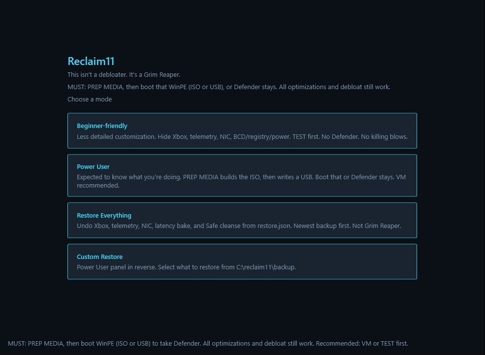
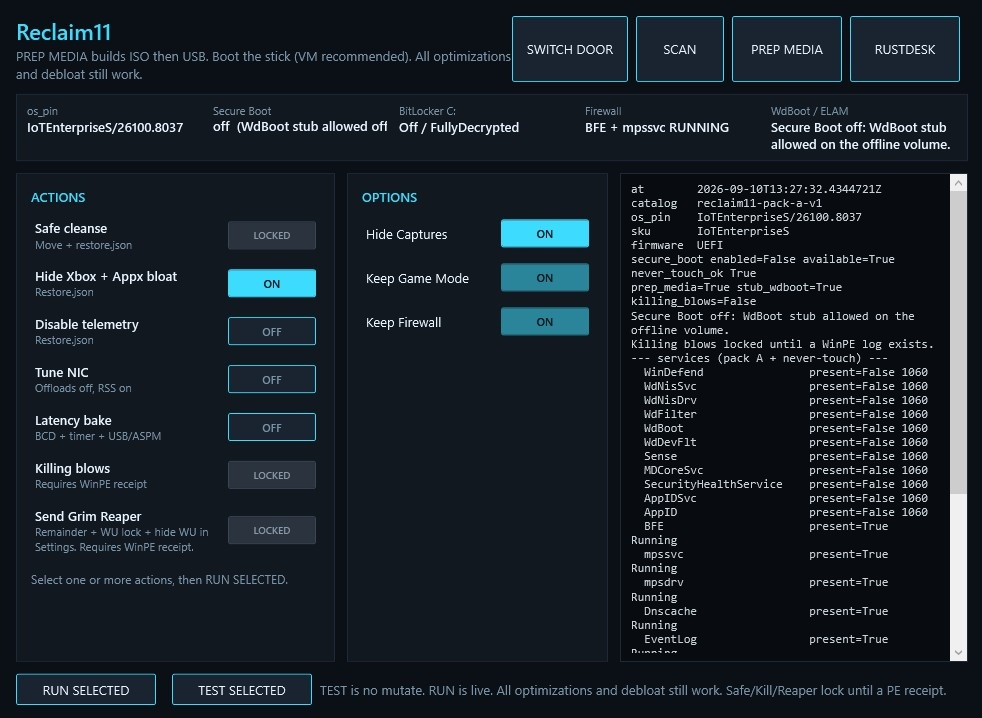
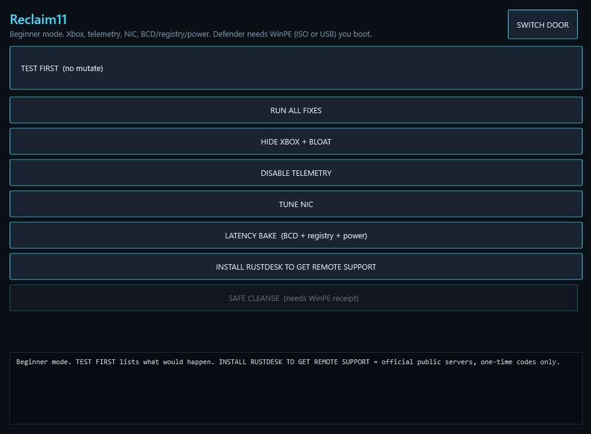

# Reclaim11

**Current standalone kit: Reclaim11 v13.**

**Recommended:** run it on a VM like VMware first, or at least run TEST
mode and see the result.

**MUST:** PREP MEDIA, then boot WinPE (ISO or USB) if you want Defender /
PPL / Sense gone. That offline pass is the kill. Without that boot **all optimizations and debloat still work** (Xbox,
telemetry, NIC, Start junk, BCD timer, USB/ASPM, power registry).
Killing blows and Grim Reaper stay locked until a WinPE receipt. Exact
flags are under Advanced.

## New in v13

- NIC tuning includes hardware-targeted `TcpAckFrequency` / `TCPNoDelay`
  writes; latency bake includes the mouse queue and NVIDIA registry profile.
  The [profile table](#added-tcp-input-and-nvidia-profile) lists exact values
  and separates actual writes from read-only Games/input inspections.
- Typed, device-bound backups preserve original values, types and absence.
  Repeated BCD rollback is checked and idempotent; restore failures are reported.
- The [GUID reference](#finding-the-power-plan-and-usb-setting) distinguishes
  power schemes, subgroups, individual settings and device-specific identifiers.
  Missing settings are skipped; High Performance activation remains opt-in.
- The standalone ZIP includes the current UI screenshots and v13 media-builder
  defaults. Shipped PowerShell scripts use explicit UTF-8 encoding for
  Windows PowerShell 5.1 / WinPE readers. It does not include a prebuilt WinPE ISO.

## What to do

1. Get `Reclaim11-kit-v13.zip` from
   [GitHub Releases](https://github.com/usrname1git/GodBrain/releases/tag/reclaim11-v13)
   and unzip it. Check the `.sha256` next to the zip.
2. Double-click `Reclaim11.cmd`. You do not type `pwsh`. The `.cmd` hops
   to a hidden host so Windows Terminal does not stay as an empty black
   window. If you only have Windows PowerShell 5.1, the GUI offers the
   official PowerShell 7 MSI (adds PATH). WinPE stays 5.1.
3. Then pick a door:
   - **Beginner-friendly:** Can hide Xbox, disable telemetry, optimize NIC, BCD/registry/power schedule. It's not touching Defender. No killing blows.

   - **RUN ALL FIXES** applies all possible. Restore from the first screen.

   - *TEST FIRST* will show what would be the result so you can see it before deciding to commit.
   Nothing is edit or deleted. Read the log.


   - **Power User:** **PREP MEDIA** builds the WinPE ISO if missing, then writes a USB (formats the stick).
   - Boot the ISO or the stick. After Windows is up, SCAN.
     Killing blows / Grim Reaper unlock only after that boot.

   - *TEST SELECTED* will show what would be the result so you can see it before deciding to commit.

Game Mode stays. The Xbox controller driver stays.







## Advanced

Pack A is Defender / PPL / Sense / AppID. Hide Xbox also clears named
Start junk (Copilot, new Outlook, Clipchamp, WhatsApp, LinkedIn, …) and turns off Start
Recommended. Photos, Calculator, Store, Notepad stay. Game Mode stays.
The Xbox controller driver (`xboxgip`) stays.

VMware CD/DVD browses the **host**. Copy
`C:\Reclaim11\Reclaim11-WinPE-v13.iso` out of the VM, then attach that
host path. USB EFI is the same WinPE.

### Rails

- Defender / PPL **require** a WinPE ISO you build and boot. No receipt: all optimizations and debloat still work.
- `WdBoot.sys` is ELAM. **Refuse to park/stub it when Secure Boot is on.**
- Killing blows / Grim Reaper unlock only after a WinPE receipt.
- WinPE waits **12 seconds**: press **H** if Windows won't boot (skips Automatic Repair). Otherwise pack A runs as today. Help writes `reclaim11-winre-skip.log` and does **not** unlock killing blows.

### In-Windows without PE (exact flags)

These are the Expert/noob actions that do not need a WinPE receipt.
`restore.json` is written first.

- **BCD `{current}`:** `nx AlwaysOff` (DEP off), `tscsyncpolicy Enhanced`,
  `hypervisorlaunchtype Auto`, `vsmlaunchtype Off`, `sos No`,
  `useplatformclock No`, `useplatformtick No`, `disabledynamictick Yes`.
  `{bootmgr}` `bootmenupolicy Legacy`.
- **HKLM:** `GlobalTimerResolutionRequests=1`,
  `SystemResponsiveness=10` (0–9 clamp to 20),
  `Win32PrioritySeparation=38`, `MouseDataQueueSize=200` under
  `SYSTEM\CurrentControlSet\Services\mouclass\Parameters`.
  The mouse value is a requested profile value, not a measured latency
  improvement. TEST lists its before/after values; restore reinstates the
  original DWORD or removes the value if it was originally absent.
- **Power (AC, active plan + High Performance if listed):** USB selective
  suspend Off, USB 3 link power Off, PCIe ASPM Off. GUI **asks** before
  `/setactive` High Performance. CLI needs `-SwitchHighPerformance`.
  Not min processor 100%. Not C-state kill. AGGRO (`61329e62`) and
  Ultimate (`e9a42b02`) refused.

### Added TCP, input and NVIDIA profile

The supplied `reclaim11_adds.txt` contains both writes and read-only
queries. The explicit writes below are implemented in the indicated
actions, including RUN ALL FIXES. TEST reports them without applying
them. The query-only entries are pre-apply inspections in the latency
report and receipt; no replacement values are invented.

| Entry | Requested value | Disposition |
| --- | --- | --- |
| `TcpAckFrequency`, `TCPNoDelay` | DWORD `1` each | NIC tuning. Map connected physical Ethernet adapters' `InterfaceGuid` values to `Services\Tcpip\Parameters\Interfaces\{GUID}`. Do not sweep stale/VPN/virtual interfaces. Each requested registry write is read back before being reported as applied. |
| MMCSS `Tasks\Games`: `GPU Priority`, `Priority`, `Scheduling Category`, `SFIO Priority` | Query only; no replacement values supplied | Report the current values, kinds and absence. Microsoft documents `GPU Priority` as not yet used and `SFIO Priority` as unused; the inspection does not change either value. |
| `mouclass\Parameters\MouseDataQueueSize` | DWORD `200` | Implemented in latency bake, including TEST and the existing backup/restore path. No automatic keyboard counterpart. |
| `kbdclass\Parameters\KeyboardDataQueueSize` | Query only; no replacement supplied | Report the current value or absence; no write. |
| Enumerate `mouclass\Parameters` properties | Query only | Report property names without changing them. |
| USB selective suspend / USB 3 link power | AC `0` | Already in latency bake. Stable subgroup/setting IDs; DC remains untouched. |
| NVIDIA `DisableLinesetting` | DWORD `1` | Latency bake. Resolve each present NVIDIA display device to its actual display-class instance; never assume `0000` is NVIDIA. |
| NVIDIA `PowerMizerEnable`, `PerfLevelSrc` | DWORD `0`, DWORD decimal `3322` | Latency bake. Read the present device's `Device Parameters\VideoID`, validate its driver/vendor mapping, then target that `Control\Video\{VideoID}\0000` only. The before-values cover the supplied read-only probes. Decimal `3322` is `0x0CFA`, not `0x3322` (decimal `13090`). |

Registry write verification proves the requested value/type was stored,
**not** a frametime improvement, driver consumption, P2 change or maximum
VRAM clock. This implements the requested profile without turning its
performance rationale into an automatic verified claim. MMCSS reference:
[Microsoft's task registry settings](https://learn.microsoft.com/windows/win32/procthread/multimedia-class-scheduler-service#registry-settings).

Backups preserve the original registry value kind/data and absence. New
NIC and latency backups have unique stamp directories, so consecutive
actions cannot overwrite one another's `restore.json`. Existing older
restore files remain supported. Restore order uses full UTC receipt times,
not mixed old/new directory names; invalid timestamps fail explicitly.
Device-bound apply/restore rechecks
identity and refuses changed/missing mappings rather than writing a new
adapter's key. No matching hardware is a reported skip; discovery,
permission, write/readback and restore errors are reported as failures.
The GUI logs applied/failed counts and inspection results; restore
failures also reach the aggregate restore result. These actions refuse
live apply/restore in WinPE.
Repeated BCD restore treats an originally absent element as restored only
after a successful enumeration confirms it is absent. BCD enumeration and
delete failures remain explicit failures, not assumed absence or success.
CLI apply/restore returns a nonzero exit code when its receipt contains
failures. Use the updated workers to restore new receipts; the older
installed kit does not understand the new typed/device-bound fields.

### Finding the power plan and USB setting

Power configuration has three separate identifiers:

```text
scheme GUID -> subgroup GUID -> setting GUID -> AC or DC value index
```

The scheme chooses the plan. The subgroup groups settings within that plan;
the setting selects one option. Neither a subgroup nor a setting GUID is a
replacement for the scheme GUID. The AC/DC index is a numeric value, not
another GUID. Reclaim11 writes the three settings below to **AC only**.

| Kind | Identifier | Use |
| --- | --- | --- |
| Standard High Performance scheme | `8c5e7fda-e8bf-4a96-9a85-a6e23a8c635c` | `SCHEME_MIN`; tune it only when listed, activate only after consent. |
| USB subgroup | `2a737441-1930-4402-8d77-b2bebba308a3` | Parent of both USB settings below. |
| USB selective suspend setting | `48e6b7a6-50f5-4782-a5d4-53bb8f07e226` | Requested AC index `0`. |
| USB 3 link power setting | `d4e98f31-5ffe-4ce1-be31-1b38b384c009` | Requested AC index `0`. |
| PCI Express subgroup | `501a4d13-42af-4429-9fd1-a8218c268e20` | Parent of ASPM. |
| PCIe ASPM setting | `ee12f906-d277-404b-b6da-e5fa1a576df5` | Requested AC index `0`. |

Built-in IDs are **not unique per Windows installation**. High Performance
is `8c5e7fda-e8bf-4a96-9a85-a6e23a8c635c`, alias `SCHEME_MIN`
(minimum power savings). Custom/imported/duplicated plans may use other
GUIDs. Friendly names can be localized or renamed; do not match the
English words "High performance". The `*` from `/list` marks whichever
plan is active, not necessarily High Performance.

Other registry GUIDs need different handling. The display-class GUID
`{4d36e968-e325-11ce-bfc1-08002be10318}` identifies a standard device class;
its `0000` / `0007` instance suffix does not identify a vendor. NIC
`InterfaceGuid` and NVIDIA `VideoID` are discovered from the current devices,
not copied from another machine. Apply and restore recheck those bindings.
Sharing a GUID-shaped spelling does not make these power-plan identifiers.

Read-only discovery:

```powershell
powercfg /list
powercfg /getactivescheme
powercfg /aliases
# Enumerate subgroups and settings, including hidden settings.
powercfg /qh SCHEME_CURRENT
# Query the USB subgroup of the active plan.
powercfg /query SCHEME_CURRENT 2a737441-1930-4402-8d77-b2bebba308a3
```

The failing example used subgroup
`2a737441-1bc3-410e-a775-8a3d423a73a6`. The USB subgroup is
**`2a737441-1930-4402-8d77-b2bebba308a3`**. USB selective suspend is
`48e6b7a6-50f5-4782-a5d4-53bb8f07e226`; USB 3 link power is
`d4e98f31-5ffe-4ce1-be31-1b38b384c009`. The third setting-GUID filter
also succeeded with `/query` and `/qh` on the investigated Windows host;
the incorrect subgroup, not that extra argument, caused its failure.

**Current implementation:** discover active/listed GUIDs, tune the active
allowed plan and listed standard High Performance, skip settings whose
before-values cannot be read, and switch only after GUI consent or
`-SwitchHighPerformance`. If High Performance is absent, report that and
tune the active allowed plan only. There is no automatic plan restoration.

Scheme discovery extracts GUIDs rather than matching localized friendly names.
However, the current before-value parser still expects the English
`Current AC Power Setting Index` line from `powercfg /qh`. An unavailable or
unparseable value, including a localized label, is reported as skipped; v13
does not yet provide locale-independent power-index reads. Power writes use
`powercfg` exit status; the registry readback guarantee described above does
not imply a separate power-index readback or a measured performance gain.

**Recommended recovery follow-up, not implemented:** use the PowrProf APIs
to enumerate GUIDs/read AC indexes without parsing localized labels.
If the standard plan is absent, check and attempt
`PowerRestoreIndividualDefaultPowerScheme` for that GUID only, inspect its
Win32 result, then re-enumerate and verify before offering activation.
The API uses the default-user restoration data; absent/inaccessible data
or an unsupported plan is a reported failure, not permission to reset all
plans. Preserve the prior plan/settings first, keep activation opt-in,
and read back every requested setting. Prefer `powercfg /setacvalueindex`
or the corresponding power API over constructing/writing raw power
registry paths.

Do **not** automatically run `powercfg /restoredefaultschemes`: it
deletes/replaces existing schemes and settings, including custom plans.
References: [powercfg](https://learn.microsoft.com/windows-hardware/design/device-experiences/powercfg-command-line-options),
[individual restore](https://learn.microsoft.com/windows/win32/api/powrprof/nf-powrprof-powerrestoreindividualdefaultpowerscheme),
[full restore](https://learn.microsoft.com/windows/win32/api/powrprof/nf-powrprof-powerrestoredefaultpowerschemes).

### Two PE profiles

- **Operator PE:** `reg delete` pack-A service keys in the offline hive
  and **delete** catalog `.sys` (no sidecar `.bak` in `drivers\`).
  Never a usermode EXE over a driver.
- **GUI Safe cleanse:** move-only into `C:\reclaim11\backup\<stamp>\`
  plus `restore.json`. Restore with
  `Restore-Reclaim11Noob.ps1 -Manifest restore.json`. Does not delete.

### WinPE ISO (Defender)

ADK + WinPE addon **10.1.26100.2454**, not ADK 28000. PREP MEDIA
asks Yes/No if the pair is missing; Yes installs it and keeps going.
The kit zip ships `winpe\reclaim11-stub.exe` (MZ). PREP does not need Visual Studio.

```text
pwsh -NoProfile -File .\scripts\New-Reclaim11WinPeIso.ps1
```

Output: `C:\Reclaim11\Reclaim11-WinPE-v13.iso`.
v1/v2 copied EXE over `.sys` and bootloop; do not attach those.

### Boot the ISO in VMware

The VM CD/DVD picker browses the **host**, not the guest. Copy
`C:\Reclaim11\Reclaim11-WinPE-v13.iso` out of the VM (shared folder or
drag-drop), then VM Settings → CD/DVD → Use ISO image file → that host
path. EFI firmware. Boot the CD (firmware menu). USB EFI passthrough of
the PREP stick is the same WinPE; VMware USB is slow, not a kit hang.
Never boot this ISO or stick on the machine that built it.

Delete the ISO and click PREP MEDIA again after a kit update — an
existing ISO skips the rebuild, and both ISO and USB bake scripts into
`boot.wim`.

PREP prefers the v13 filename but retains older ISO discovery for compatibility.
If only an older ISO exists, it can be reused instead of rebuilt. Remove the
outdated ISO before preparing v13; renaming an old ISO does not update its
embedded scripts.

Snapshot, attach **v13**. PE **deletes** catalog
`drivers\WdBoot.sys` / `WdFilter.sys` / `WdNisDrv.sys` / `WdDevFlt.sys`
(exact names, never a `Wd*.sys` glob), stubs catalog usermode EXEs,
`reg delete` pack-A keys then Start=4 fallback, IFEO +
`DisableAntiSpyware` in the **offline hives**. Live Windows IFEO is
the wrong door (Tamper/PPL ACL). Disconnect ISO. `wpeutil reboot`.

Secure Boot on: refuse `WdBoot` delete and still boot. Secure Boot off
may drop ELAM.

After reboot, in-Windows `Apply-KillingBlows.ps1` is leftover `sc delete`,
Defender/ExploitGuard scheduled tasks (those two folders only), and delete
of `HKLM\SOFTWARE\Microsoft\Windows Defender` (resurrection lock). GPO
`DisableAntiSpyware=1` stays. Killing blows writes `restore.json` (task XML
under `tasks\`) before the deletes.

Optional remainder: `grim_reaper.ps1` (GUI: Send Grim Reaper).
**Deletes** named drivers, never stubs `.sys` / `.cip`. After 26H1 it
also locks WU resurrection (`wuauserv` / `UsoSvc` / `WaaSMedicSvc` and
named task folders) and hides Windows Update in Settings
(`hide:windowsupdate;…`, Game Mode stays) and
`SetDisableUXWUAccess=1` (System page Check for updates chrome).
`pwsh -File grim_reaper.ps1 -SelfTest`.
Old filename `NuclearDefenderWipe-V6_3.ps1` still launches this script.

Physical USB is a **separate** script (ISO builder stays `/ISO` only):

```text
pwsh -NoProfile -File .\scripts\New-Reclaim11WinPeUsb.ps1 -T
pwsh -NoProfile -File .\scripts\New-Reclaim11WinPeUsb.ps1 -DiskNumber N -Go
```

### Hide Xbox, telemetry, NIC

**Hide Xbox** (in-Windows): `restore.json` first, then Settings hide so
Gaming is Game Mode only. Does **not** write `AllowAutoGameMode`.
Does **not** delete `xboxgip`. Does **not** remove
`Microsoft.XboxGameCallableUI`. Admin (UAC). Restore:
`pwsh -File xbox_cleanse.ps1 -Restore restore.json`.

**Disable telemetry:** `AllowTelemetry=0`, `DiagTrack` + `dmwappushservice`
start=disabled. Restore:
`pwsh -File telemetry_cleanse.ps1 -Restore restore.json`.

**Tune NIC** (Ethernet only): EEE/interrupt moderation/flow/WoL off,
checksum/LSO/VLAN-priority off, RSS on, Rx/Tx **256–512**. Does not
force Speed/Duplex. Skips VMware host VMnet / Tailscale / Wi-Fi.
Also sets `TcpAckFrequency=1` and `TCPNoDelay=1` on connected physical
Ethernet interfaces, with typed backup, binding checks and readback.
`pwsh -File nic_tune.ps1 -T`.

**Latency bake** (Expert, in-Windows): flags are under
**In-Windows without PE** and **Added TCP, input and NVIDIA profile**
above. Includes the requested NVIDIA registry profile when a matching
present device exists, and read-only Games/input inspection. WinPE MiniNT refused (that would be
the PE BCD). `pwsh -File latency_bake.ps1 -T`. Restore:
`pwsh -File latency_bake.ps1 -Restore restore.json`.

**RustDesk** (in-Windows, not WinPE): Expert **RUSTDESK** button
chooses permanent password (type it / generate and show once / one-time
only) and whether to install the unattended service (default on).
Beginner mode is one button, **Install RustDesk to get remote support**,
one-time codes only. Official public RustDesk servers. Pinned GitHub
release + SHA256 in `catalog.json` (not latest). Password is never
logged. `pwsh -File rustdesk.ps1 -T`.

Killing blows / Grim Reaper self-elevate to TrustedInstaller via Task
Scheduler (Admin → SYSTEM → TI). No wsudo / MinSudo. WinPE is already
SYSTEM and skips that hop.

### From this repo

Run `Test-Reclaim11.ps1` on a VM. Not physical hardware.
`scripts\Test-Reclaim11Optimizations.ps1` is a separate mocked/offline
registry/device regression suite; it never invokes real tuning.

```text
godbrain_core\reclaim11\Reclaim11.cmd
pwsh -NoProfile -File godbrain_core\reclaim11\ps1\Reclaim11.ps1 -T
pwsh -NoProfile -File .\scripts\New-Reclaim11KitZip.ps1
.\scripts\Test-Reclaim11.ps1
```

Headless inventory: `Reclaim11.ps1 -InventoryOnly`. GUI transcripts to
`%LOCALAPPDATA%\Reclaim11\logs`.

BitLocker in the VM is optional; if C: is encrypted, WinPE needs the
protector.

Brave bloat is a **policy overlay** in `brave-policy\`, not a forked browser.
